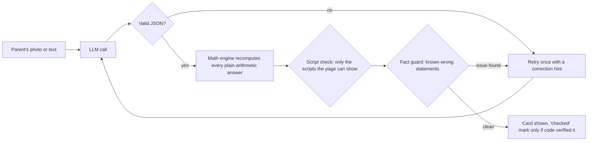

# Tut-P AI Guardrails

**The checks that stand between an LLM and a parent.**

[Tut-P](https://tutp.online) is a homework-help app for Indian families. A parent photographs a worksheet, and the app returns answers and parent-friendly explanations in English, Telugu, Hindi and other Indian languages, generated by Claude and Gemini.

A wrong answer shown to a parent is worse than no answer: the parent teaches it to the child. So no model reply reaches the screen until code has checked it. This repository contains those checks, extracted from the production codebase with their unit tests.

```
npm test        # 42 tests, Node 20+, no dependencies, no API keys
```

## The pipeline



Each check returns a reason. Any failure triggers exactly **one** retry, and the reason is turned into a plain-English hint for the model (for example: *"Your previous reply contained a letter from a wrong script inside a word"*). If the second reply still fails, the server returns a clear error instead of a doubtful answer.

## What each module does

| Module | Problem it solves | Production incident behind it |
|---|---|---|
| `src/math-engine.js` + `src/arith-check.js` | Recomputes every plain-arithmetic answer in code. Handles `+ − × ÷`, brackets, decimals, simple fractions, one blank in an equation, and digits in 10 Indian scripts. The "checked" mark comes only from here, never from the model. Word problems are left "unchecked" rather than falsely marked. | A photo reply copied the child's written `45 − 18 = 33` as the answer. |
| `src/lang-check.js` | Rejects any letter from a script no Tut-P page uses, Hindi written in Latin letters, and replies written in the wrong language. | A Georgian letter appeared inside a Telugu word in a generated note. |
| `src/fact-guard.js` | A growing list of statements the model has actually got wrong, each with a regex and a correction hint. A new rule is added whenever a human review finds a wrong fact. It currently holds one rule; the value is the process, not the size. | "Cold air sinks at the subtropical high" (it is descending air that rose at the equator). |
| `src/homework-reply.js` | Validates that the reply contains parseable JSON and retries once. | Occasional missing commas mid-array broke the parent's page. |
| `src/model-cost.js` | Computes USD cost per call from the usage block, including prompt-cache reads and writes, and logs one row per call (retries included). | Every paid call must be visible per feature and per family. |
| `src/model-replay.js` | Record and replay of model replies keyed by a hash of the request content, so the end-to-end suite runs with **zero model spend**. A missing recording is an error, never a silent live call. Only active on preview revisions and test families. | Without it, every E2E run would call paid models. |

## How it fits the full system (not included here)

- **Stack:** Node.js + Express on Google Cloud Run, Supabase (Postgres), Anthropic Claude and Google Gemini APIs.
- **Golden set:** a recorded set of real homework cases checked on every prompt or model change: schema validity, numerical correctness, question-type layout, required keywords, and the language of the explanation. Telugu output is also reviewed by a native speaker.
- **E2E:** Playwright suite run against a no-traffic preview revision in replay mode before any traffic moves.
- **Operations:** a daily model-health cron makes a tiny call to each provider and alerts when calls fail or the 24-hour error rate passes 10%. No key, prompt or raw upstream body is ever logged.

## Design choices

1. **Code decides correctness where code can.** Arithmetic is not a language task, so the model is not trusted with it.
2. **One retry, with a reason.** Unbounded retries hide bad prompts and multiply cost. One informed retry fixes most format and script glitches.
3. **Never a false "checked".** An answer the engine cannot verify is shown without a mark rather than with a wrong one.
4. **Every incident becomes a test.** Each module above exists because of a real failure, and each failure is now a test case.

## How this was built

I am the founder and product owner of Tut-P. I designed the product, the quality bar and these checks, and reviewed the failures they came from. The code was implemented with Claude Code as my engineering agent, under rules I set: every status claim verified against the repo, every deploy verified independently, every incident turned into a test.

## Contact

Sreepada Ramana Chary (Vet) · sripada.ramanachary@gmail.com

This repository is a read-only extract for review. The full Tut-P codebase is private.
